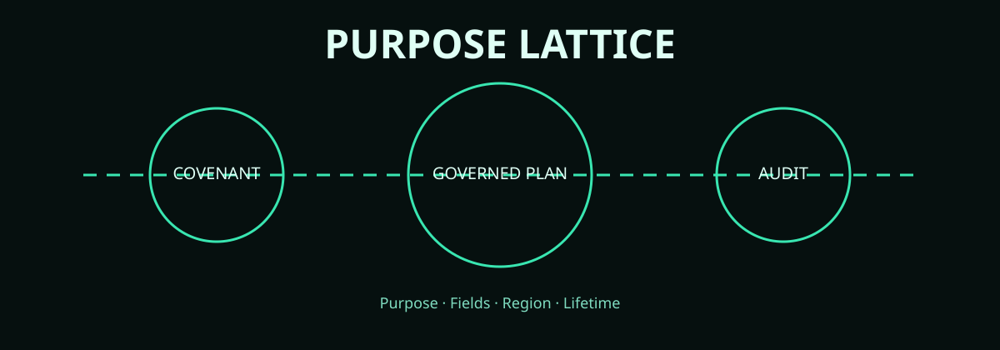
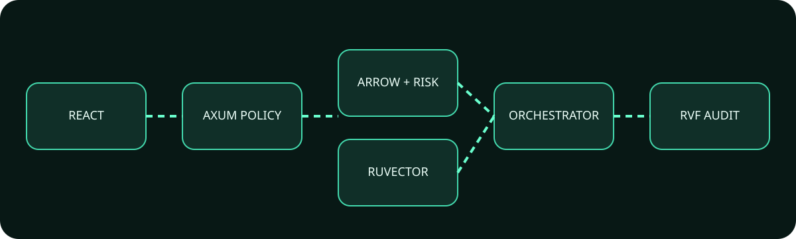
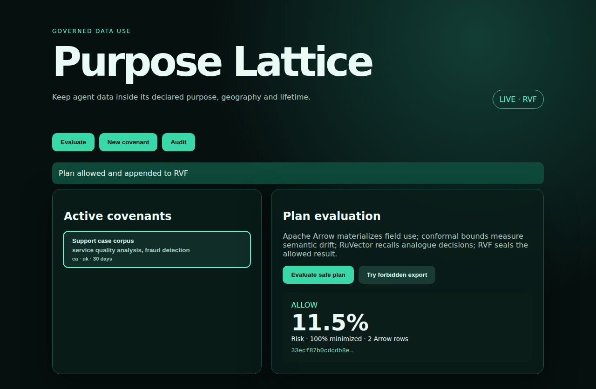
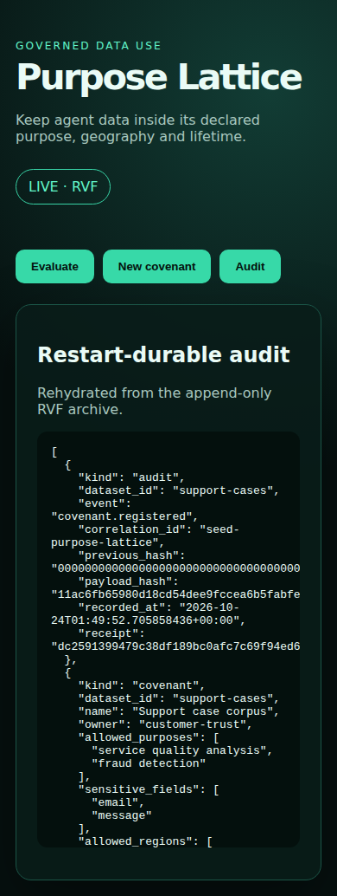

<p align="center"></p>

# Purpose Lattice

[](https://www.rust-lang.org/)
[](https://react.dev/)
[](https://arrow.apache.org/)
[](https://github.com/nicholas-ruest/purpose-lattice/actions/workflows/ci.yml)

Purpose Lattice is a full-stack data-use control plane for agent systems. It turns a declared data covenant into an enforceable pre-effect decision over semantic purpose, selected fields, processing operation, geography and retention—then preserves allowed outcomes in an append-only RVF audit.

It executes **RuVector Core 2.4.0** for analogue recall, **RVF Runtime 0.3.2** as the sole prototype persistence layer, and **Apache Arrow Rust 60.0.0** for column-level processing-plan evidence. A split-conformal semantic-drift bound and information-flow taint lattice materially change the decision path.

## Run

```bash
./scripts/bootstrap.sh && ./scripts/start-prototype.sh
```

Open `http://127.0.0.1:14273`; API health is `http://127.0.0.1:18180/readyz`. Stop with `./scripts/stop-prototype.sh`. Execute the complete gate with `./scripts/verify-prototype.sh`.

## Product journeys

1. Evaluate an allowed support-quality plan through the real UI, session middleware, Arrow, conformal/taint logic, RuVector and RVF.
2. Attempt a forbidden sensitive export, observe the typed denial and prove no plan was appended; submit a corrected plan to recover.
3. Refresh or restart and retrieve the same audit from RVF.

<p align="center"></p>

## Executed composition

| Ingredient | Pinned source | Executed boundary | Removal signal |
|---|---|---|---|
| RuVector Core | 2.4.0 / `46d816ddc4c2a8a06cd3613534a79b1d557d858b` | `VectorDB::insert` and `VectorDB::search` provide analogue-policy recall | Ruvnet-only baseline loses typed column evidence and enterprise processing semantics |
| RVF Runtime | 0.3.2 / `46d816ddc4c2a8a06cd3613534a79b1d557d858b` | `RvfStore` appends and reopens auditable decisions | Restart retrieval and append-only evidence disappear |
| Apache Arrow Rust | 60.0.0 / `b391e5af7dff9f6909af45c01f7dddb68ba08c0f` | `RecordBatch` carries the selected-field execution plan | Capability score falls from 0.910 to 0.710 |
| Split conformal bound | local implementation, ADR-0009 | Bounds semantic-purpose drift before effects | Capability score falls from 0.910 to 0.790 |
| Taint lattice | local implementation, ADR-0010 | Propagates sensitivity through operations and sinks | Forbidden export can no longer be rejected by lattice order |

## Measured benchmark and ablations

The deterministic 50-plan run used the checked-in seed namespace. Scores are evaluation capability, not production accuracy claims.

| Configuration | Capability score | Delta from combined |
|---|---:|---:|
| Combined | 0.910 | — |
| Without conformal bound | 0.790 | -0.120 |
| Without Apache Arrow | 0.710 | -0.200 |
| Ruvnet-only | 0.430 | -0.480 |
| Enterprise-only | 0.380 | -0.530 |

Benchmark: 50 allowed decisions, mean measured risk `0.1150`. Raw receipts are in [`evidence/prototype`](evidence/prototype/).

## Workspace and evidence

The 24 Rust crates cover typed contracts, covenant/plan domains, assurance mechanisms, Apache Arrow, RuVector/RVF, governance, middleware, orchestration, delivery and evaluation. See [architecture](docs/architecture.md), [integration matrix](docs/integration-matrix.md), [prototype acceptance](docs/prototype-acceptance.md), [25 ADRs](docs/adrs/README.md), [12 DDD documents](docs/ddd/README.md) and [research](docs/research.md).

| Desktop evaluation | Mobile audit retrieval |
|---|---|
|  |  |

The real-backend Playwright suite produced these screenshots and its trace/report. The evidence manifest binds commands, timestamps, hashes, launch mode and the tested source identity.

## Maturity and limitations

This is a high-fidelity prototype, not a production privacy or legal-compliance product. Deterministic embeddings and fixtures make evidence reproducible but require production calibration. Dev-session role selection must be replaced by IAP/OIDC. Local RVF proves the storage boundary; Cloud Run requires an authorized durable RVF service because its filesystem is ephemeral. No cloud deployment, spend, legal determination or production readiness is claimed.

Licensed MIT OR Apache-2.0.
